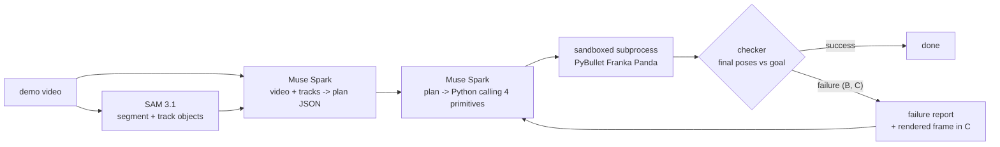
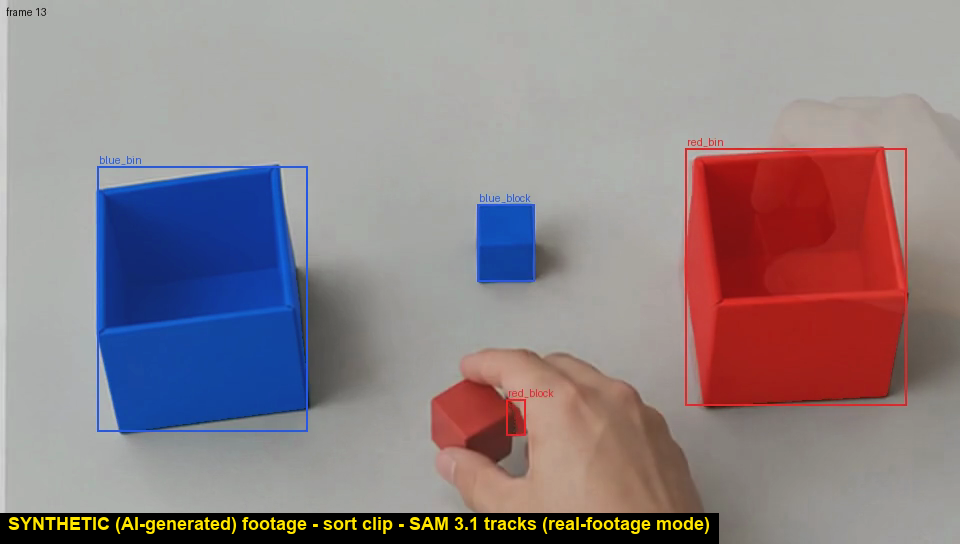
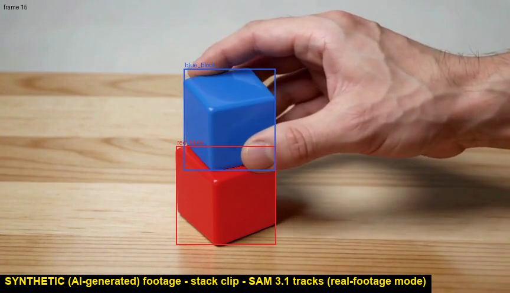
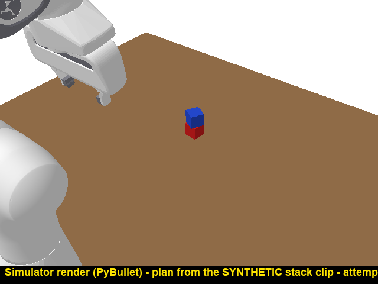

# Core Robot

Core Robot learns a tabletop task from one demonstration video and performs it with a simulated
Franka Panda arm in PyBullet; everything runs in simulation only. The model never controls
joints: it writes Python that calls four primitives (`pick`, `place`, `move_above`,
`open_gripper`). Success is judged from the simulator's final object poses, never by asking a model.

See [PROJECT.md](PROJECT.md) for the brief.

## Pipeline



| Component | Role |
|---|---|
| SAM 3.1 (`sam-3.1`) | Segments and tracks each named object through the demo video. |
| Muse Spark (`muse-spark-1.3`) | Names the objects, turns video + tracks into a structured plan (JSON), and writes the Python `run(robot, scene)` that calls the four primitives. |
| Muse Code | Used only as a development tool while building this repo; not part of the pipeline. |
| PyBullet + Franka Panda | Runs the generated code in a sandboxed subprocess with a timeout. |
| Checker | Tests final object poses against the plan's goal relations (`in`, `on`, `left_of`, ...). |
| Repair loop | A: one shot. B: up to 3 attempts, each retry gets a text failure report. C: as B plus a rendered frame of the final state. |

## Results

All numbers come from live API runs. Prompt hash `6faa3b19e9b6` (git tag `prompts-frozen-v1`)
for every run. Details: [docs/findings_v1.md](docs/findings_v1.md),
[docs/findings_real_v1.md](docs/findings_real_v1.md), [docs/perturbation_pilot.md](docs/perturbation_pilot.md).

### Simulator demos (8 tasks x 5 seeds, plans predicted from the demo video)

| Measure | Result |
|---|---|
| Planner, strict match with the ground-truth plan (10 demo videos) | **9/10** (lenient, goal atoms only: 9/10) |
| SAM gate (every block and bin found and tracked, 10 demo videos) | **10/10** |
| Clean environment, A / B / C | **36/40 / 40/40 / 40/40** |
| Perturbed environment (4 cm release offset), A | **21/40** |
| Perturbed environment, B and C | **incomplete**: 38 of 80 runs ran before the budget stop; **0 of 9** repairable runs fixed in B and **0 of 9** in C |

The repair loop showed **no gain in the perturbed environment**. In the clean environment, repair
fixed 4 runs in B and 4 in C, all of them t8, and broke none.

### Synthetic clips (AI-generated, not real footage)

Two checks, kept separate: `plan_matches_clip` compares the generated plan with a hand-labelled
expected plan for the clip; simulator success only checks that the robot carried out the plan's own
goals.

| Clip | Task | plan_matches_clip | Simulator | Notes |
|---|---|---|---|---|
| `synthetic_sort_red_blue` | red cube -> red box, blue cube -> blue box | True | success, attempt 1 | correct tracks only after the real-footage perception mode |
| `synthetic_stack_blue_on_red` | blue cube on red cube (expected plan written blind) | True | success, attempt 1 (v1 and v2) | v1 wrongly rejected both cube tracks; fixed in v2 |

Two clips, one run per configuration: **not a success rate.**

| Sort clip, SAM tracks | Stack clip, SAM tracks | Simulator, stack clip plan |
|---|---|---|
|  |  |  |

More in [docs/media/](docs/media/) (overlay and simulator clips; every file is labelled).

### Spend

Total API spend for the whole project: **$3.915** (`scripts/spend.py`, from the call log; cache
hits are free).

## Limitations and honest findings

- **The clean environment is saturated.** A already scores 36/40; B and C reach 40/40. That leaves
  little room to measure repair.
- **The perturbed repair gain was null.** 0 of 9 repairable runs were fixed in B and 0 of 9 in C, and
  B/C are incomplete. No primitive can aim a stack off-centre, so the code cannot compensate for a
  release offset when stacking.
- **Repair fixed only t8, through goal-revealing feedback.** The failure report names the unmet goal
  (e.g. "green_block in red_bin"), which reveals the selection rule the plan lacked. This is repair
  working from information in the report, not evidence that the planner understood the demo.
- **t5_line_up seed 0 is a known planner failure.** The plan adds a step "blue_block -> red_block".
- **The plan did not depend on the track text.** In the ablation on the sort clip, correct tracks, the
  wrong tracks of the first run, and no tracks at all gave the same correct plan. One clip, one sample
  per variant.
- **Real-footage perception needed changes, found on synthetic clips.** The simulator perception path
  assumes the simulator camera. Real mode (`--footage real`) uses image-relative checks, size-based
  assignment and fragment merging. Its fixed 4% block-size limit rejected close-up cubes on the
  stack clip; block size is now judged against the clip's bins.
- **The relative size rule is strict.** A block only has to be smaller than the smallest bin. On the
  sort clip the red box is about 1% smaller than the blue box, so with no red bin named the red box
  would pass as the red block.
- **False "moved" line under occlusion.** On the stack clip the track summary says the red cube moved.
  It did not: the blue cube covered its top and shifted its box.
- **The phantom cube.** The sort clip contains a phantom blue cube (a generation artifact) that SAM
  never returns separately, so no track shows the blue cube being placed.
- **The footage is AI-generated, not real.** Both clips are synthetic. No success rate is claimed from
  two clips, and nothing here has been measured on real camera footage.

## Setup

Tested on **macOS arm64 with Python 3.12** (`requirements.txt` pins exact versions from that
machine; Python >= 3.10 is required).

```bash
python3.12 -m venv .venv
.venv/bin/pip install --find-links <dir-with-pybullet-wheel> -r requirements.txt   # see pybullet note
.venv/bin/pip install -e .
cp .env.example .env          # then put your key after MODEL_API_KEY= (.env is gitignored)
```

### pybullet on macOS

pybullet has no macOS wheels, and on recent macOS SDKs the sdist fails in its bundled zlib
(`fdopen` macro clash). Build it once locally:

```bash
.venv/bin/pip download --no-deps --no-binary :all: pybullet==3.2.7 -d /tmp/pyb
tar xzf /tmp/pyb/pybullet-3.2.7.tar.gz -C /tmp/pyb
sed -i '' '/#define fdopen(fd, mode) NULL/d' /tmp/pyb/pybullet-3.2.7/examples/ThirdPartyLibs/zlib/zutil.h
.venv/bin/pip wheel --no-deps -w /tmp/pyb/wheels /tmp/pyb/pybullet-3.2.7   # a few minutes
```

Then pass `--find-links /tmp/pyb/wheels` to the install above. On Linux, `pip install pybullet`
usually works directly.

## Run

```bash
# tests: offline, no API key, no spend (about 2 minutes)
.venv/bin/pytest -q

# UI: browse the demos and run logs; the "Run on your own video" section can call the API
.venv/bin/python -m core_robot.ui.app        # http://127.0.0.1:7860
```

### Running on your own clip (costs money)

API calls are billed. Always look at the estimate first, and set a hard budget:

```bash
.venv/bin/python scripts/run_real_demo.py data/real/<clip>.mp4 --footage real --dry-run      # estimate only, no API call
.venv/bin/python scripts/run_real_demo.py data/real/<clip>.mp4 --footage real --budget 0.5   # live; hard cap in USD
```

The budget guard reserves each call's worst-case cost before sending, so `--budget` is a hard cap.
Responses are cached by request hash; `CORE_ROBOT_REPLAY=1` serves only from the cache (no spend).
If `data/real/<clip>.expected_plan.json` exists, the run also reports `plan_matches_clip`. Outputs go
to `data/runs/real/<clip>/` (gitignored). Clips in `data/real/` are gitignored.

Other entry points: `scripts/sam_gate.py`, `scripts/eval_planner.py`,
`python -m core_robot.eval.run_eval --generator muse --dry-run` (simulator evaluation),
`scripts/spend.py` (spend from the call log).

## Repository layout

```
src/core_robot/   simulator, primitives, perception, planner, code generation, repair, eval, UI
tests/            offline tests (fake API transport + recorded SAM fixtures)
data/demos/       scripted simulator demos (videos, plans) used by tests and evaluation
data/real/        expected plans for the synthetic clips (the clips themselves are not committed)
data/samples/     synthetic placeholder images/videos drawn by scripts/make_placeholder_samples.py
docs/             findings, perturbation pilot, media (all synthetic footage is labelled)
```

## License

MIT; see [LICENSE](LICENSE).
